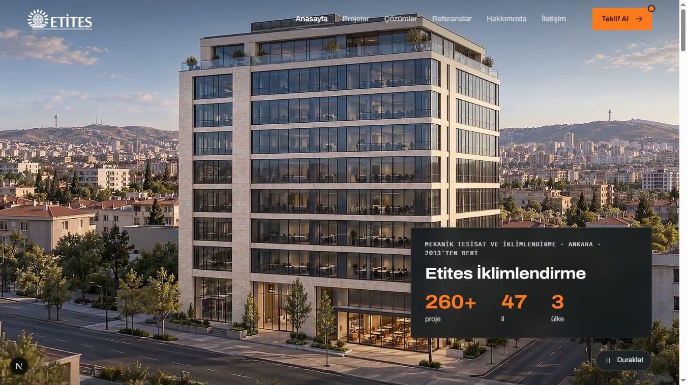
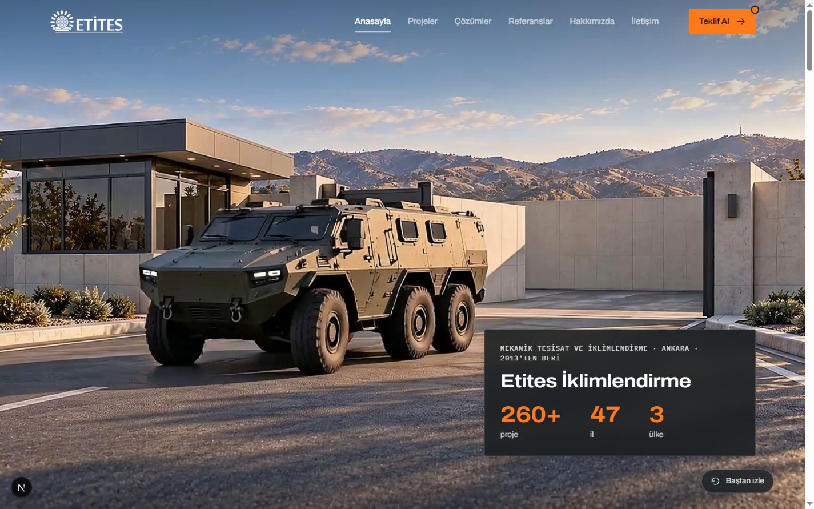
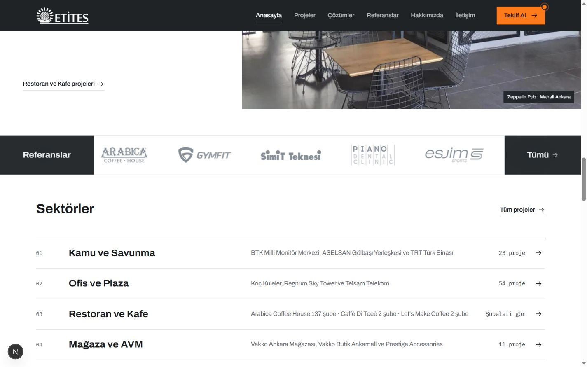

# Anasayfa filmi ve referans şeridi kontrolü

6 Ekim 2026

## Tamamlanan düzenleme

Yüklenen et1.mp4, et2.mp4, et3.mp4, et4.mp4 ve et5.mp4 sırasıyla birleştirildi. Dört birleşim noktasında önceki parçanın son karesi ile sonraki parçanın ilk karesi görsel olarak karşılaştırıldı. Kareler birbirini takip ettiği için ek karartma veya görüntü bindirme kullanılmadı.

Film 1920 × 1080 çözünürlükte, saniyede 24 kare ve toplam 904 kare. Süresi 37,667 saniye. İlk dört parça sekizer saniye, yüklenen son parça yaklaşık 5,67 saniye. Son parçanın başlangıç zaman farkı sıfırlandı. Kaynakların SHA-256 değerleri işlem öncesi ve sonrasında aynı.

| Zaman | İçerik |
| --- | --- |
| 0-8 saniye | Plaza dış görünümü ve penthouse mekanik sistemleri |
| 8-16 saniye | Aynı binanın zeminindeki kafe ve mekanik altyapısı |
| 16-24 saniye | Fabrikaya geçiş ve üretim alanındaki mekanik sistemler |
| 24-32 saniye | Fabrikadan savunma tesisi kapısına geçiş |
| 32-37,667 saniye | Kapının açılması ve zırhlı aracın çıkışı |

## Sitedeki davranış

- Film normal hızda, sessiz ve otomatik oynuyor. Scroll ile zaman çizelgesi değiştirilmiyor.
- Firma adı ve 260+ proje, 47 il, 3 ülke rakamları ilk kareden itibaren görünür. Koyu, bulanık zemin ve kalın turuncu rakamlar kullanıldı. Sayıların görünmesi için film sonu veya animasyon beklenmiyor.
- Duraklatma, devam etme ve baştan izleme düğmeleri çalışıyor.
- Film bitince son kare ekranda kalıyor. Otomatik döngü yok.
- Proje panelleri filmi örttüğünde oynatma duruyor. Yukarı dönülünce kaldığı yerden devam ediyor. İlk üç panelin kayma düzeni korundu.
- Sekme görünürlüğü ve hareket azaltma tercihi için oynatma koşulları eklendi. Hareket azaltma tercihi açıkken başlangıç görseli gösterilir ve kullanıcı isterse filmi başlatabilir. Bu tercih bu kontrolde cihaz üzerinde değiştirilmedi.
- Yükleme hatasına karşı filmin ilk karesinden alınan başlangıç görseli bulunuyor.

Referans şeridi mevcut geçiş alanında aşağı alınarak ortalandı. 1440 × 900 masaüstü görünümünde şeridin üstünde ve altında 64 piksel mesafe ölçüldü. Önceki 128 piksel mesafe ikiye bölündü, toplam dikey boşluk artırılmadı.

## Dosyalar

- Birleşmiş yüksek kalite kopya: video/anasayfa/etites-anasayfa-master.mp4, 86,25 MB
- Sitede kullanılan kopya: public/media/video/etites-anasayfa.mp4, 38,40 MB
- Başlangıç görseli: public/media/video/etites-anasayfa-poster.jpg
- Tekrar üretim betiği: scripts/build-home-video.ps1

Her iki video H.264 biçiminde ve sessiz. Site kopyasında hızlı başlangıç için MP4 başlıkları dosyanın başına yerleştirildi. Site kopyası master üzerinden tekrar sıkıştırılmadı, iki çıktı doğrudan yüklenen kaynaklardan üretildi. Kaynak videoların sesleri ve görüntüleri kendi dosyalarında korunuyor.

## Doğrulama

- FFmpeg ile site videosunun tamamı hatasız çözümlendi.
- FFprobe ile süre, çözünürlük, kare sayısı ve tek video akışı doğrulandı.
- MP4 moov başlığının mdat başlığından önce geldiği doğrulandı.
- 1440 × 900 ve 1366 × 768 masaüstü boyutları kontrol edildi. İkinci boyutta metin kutusu ile oynatma düğmesi arasında 24 piksel mesafe var, yatay taşma yok.
- Gerçek tarayıcıda sessiz otomatik oynatma, duraklatma, devam etme, örtülünce durma, geri dönünce sürdürme, son karede kalma ve baştan oynatma kontrol edildi.
- ESLint ve TypeScript kontrolü başarılı.
- Son düzenlemeden sonra üretim derlemesi başarılı. 156 sayfa üretildi.

Mobil tasarım bu çalışmanın kapsamına alınmadı.

## Ekran görüntüleri

